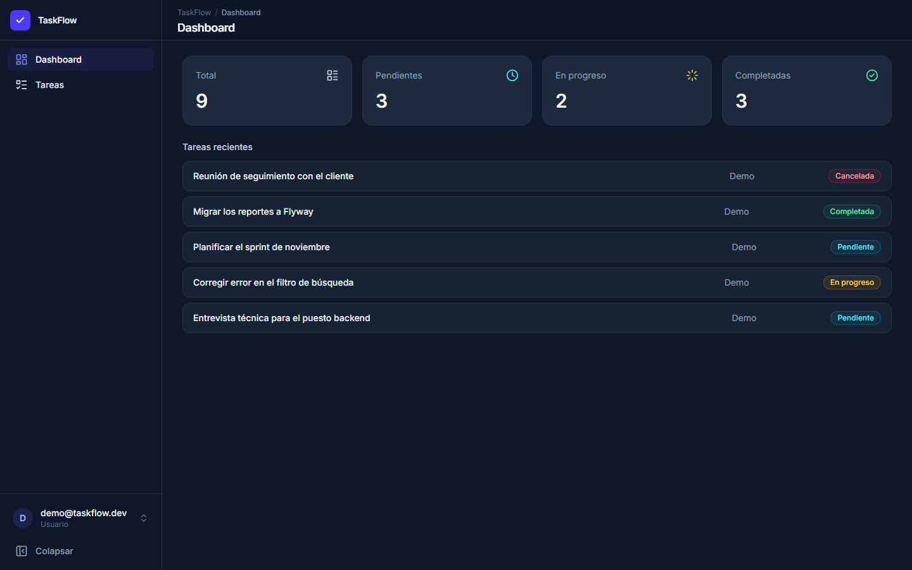
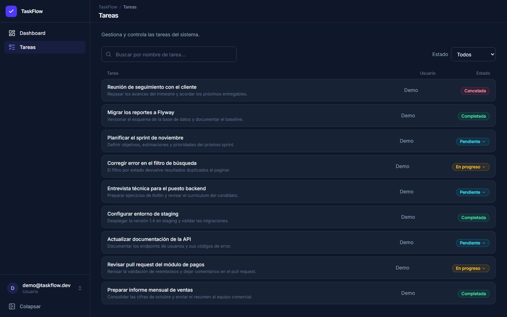
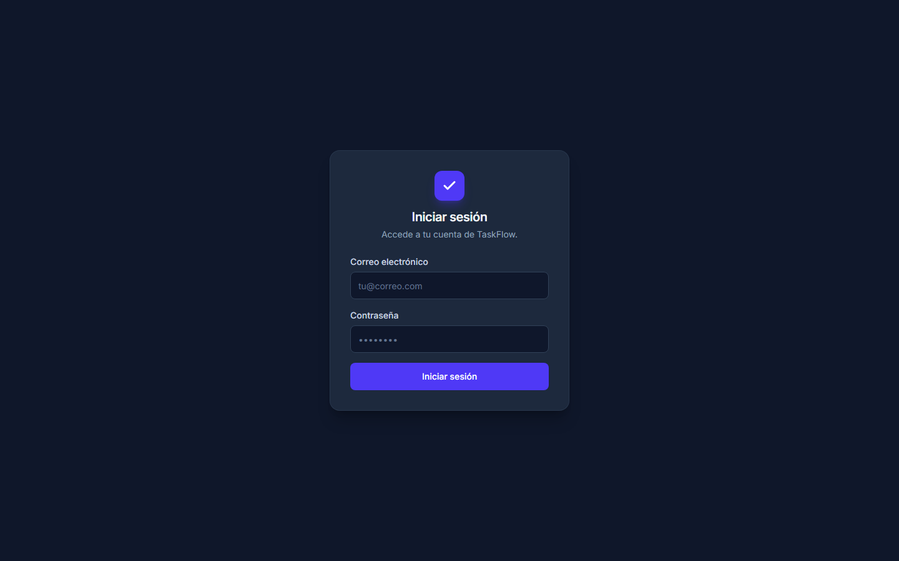
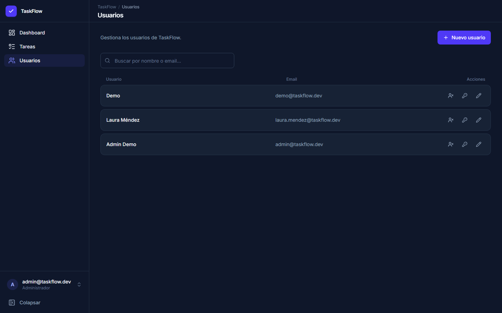

# TaskFlow

**Gestión de tareas con roles y administración de usuarios.**
Interfaz en Next.js (App Router) + TypeScript sobre una API REST en Kotlin/Spring Boot y PostgreSQL.

| | |
| --- | --- |
| **Demo en vivo** | https://taskflow-frontend-ashen.vercel.app |
| **API desplegada** | https://taskflow-api-ycus.onrender.com |
| **Repositorio del backend** | https://github.com/NAHUM099/taskflow-api |
| **Documentación técnica** | [docs/](docs/) |



## Acceso a la demo

La aplicación está desplegada en **https://taskflow-frontend-ashen.vercel.app**.

TaskFlow **no tiene registro público**: las cuentas las crea un administrador (`POST /users` exige
`ROLE_ADMIN`). Por ese motivo la demo todavía **no publica credenciales de prueba**: habilitarlas
implica crear la cuenta en la base de datos de producción, una acción manual que queda fuera de esta
etapa de documentación.

- Reglas y procedimiento para habilitar una cuenta de demostración (`USER`, datos ficticios, sin
  privilegios de administración): `docs/cuenta-demo.md` del backend, enlazado desde
  [su documentación](https://github.com/NAHUM099/taskflow-api#documentación).
- Mientras tanto, el proyecto completo se levanta en local en menos de cinco minutos con las
  [instrucciones de instalación](#ejecución-local).

> Nunca se publican credenciales de administración ni secretos de producción.

## Capturas

| Dashboard | Tareas |
| --- | --- |
|  |  |

| Login | Usuarios (solo `ADMIN`) |
| --- | --- |
|  |  |

Capturas de la aplicación en funcionamiento, con datos de ejemplo ficticios.

## Qué es TaskFlow

Coordinar tareas en un equipo pequeño suele acabar en una hoja de cálculo compartida o en un tablero
sin permisos: cualquiera ve todo y cualquiera puede romperlo. TaskFlow resuelve ese problema con un
flujo completo y deliberadamente pequeño:

- **Cada persona gestiona lo suyo**: un `USER` ve y mueve solo sus tareas.
- **Los moderadores coordinan**: `MODERATOR` puede crear tareas para cualquier persona a través de la
  API (la interfaz todavía limita el alta a `ADMIN`).
- **Un administrador controla las cuentas**: `ADMIN` es el único que crea usuarios, cambia
  contraseñas o desactiva accesos.

El propósito del proyecto es demostrar un producto real de punta a punta —autenticación,
autorización por roles, validación, paginación, estados de carga y error, pruebas automatizadas,
despliegue y documentación— sin la complejidad de una plataforma de gestión de proyectos.

## Funcionalidades

**Autenticación y sesión**

- Inicio de sesión con JWT y cierre de sesión; rutas protegidas con redirección a `/login`.
- Sesión persistente entre pestañas y mensajes de error claros en el formulario.
- Tratamiento específico del *rate limiting* del login (`429` + `Retry-After`).

**Dashboard**

- Indicadores de tareas (total, pendientes, en progreso, completadas) y listado de tareas recientes.
- Vista adaptada al rol: un `USER` solo ve sus propias cifras y tareas.

**Tareas**

- Listado paginado con búsqueda por título y filtro por estado.
- Cambio de estado con las transiciones permitidas por el backend (`PENDING`, `IN_PROGRESS`,
  `DONE`, `CANCELLED`).
- Alta de tareas desde la interfaz para `ADMIN`. La API también autoriza a `MODERATOR`, pero la UI todavía
  no le muestra el botón (ver [deuda técnica](docs/technical-debt.md)).

**Usuarios** (solo `ADMIN`)

- Listado paginado con búsqueda por nombre o correo.
- Alta, edición, restablecimiento de contraseña y activación/desactivación de cuentas.

**Experiencia de uso**

- Tema oscuro responsive, navegación lateral según el rol y tablas adaptables a móvil.
- Estados de carga (*skeletons*), estados vacíos y errores con opción de reintentar.
- Etiquetas de formulario asociadas, atributos ARIA en menús y diálogos y avisos anunciados por
  lectores de pantalla.

## Stack

| Capa | Tecnología |
| --- | --- |
| Framework | Next.js 16.4 (App Router) · React 19 |
| Lenguaje | TypeScript 5 |
| Estilos | Tailwind CSS 4 |
| Datos y estado del servidor | TanStack Query 5 · Axios |
| UI | lucide-react · sonner (notificaciones) |
| Pruebas | Vitest 5 · Testing Library · jsdom |
| Backend (repositorio aparte) | Kotlin 1.9 · Spring Boot 3.5 · PostgreSQL · Flyway · JWT |

Detalle de dependencias y versiones: [`package.json`](package.json).

## Arquitectura

```
Páginas (App Router)  src/app
        │  login + grupo (dashboard) protegido por <RequireAuth>
        ▼
Componentes  src/components          Hooks de datos  src/hooks
   auth · dashboard · layout             queries/ · mutations/
   tasks · users · providers                   │  React Query
        │                                      ▼
        └──────────►  Servicios por dominio  src/lib/services
                                     │
                                     ▼
                 Cliente HTTP (Axios + interceptores)  src/lib/api.ts
                                     │  Authorization: Bearer <JWT>
                                     ▼
                          API REST (taskflow-api)
```

- **`src/app`**: rutas `/login`, `/` (dashboard), `/tasks` y `/users`. El grupo `(dashboard)` envuelve
  las páginas privadas con `<RequireAuth>`, y `/users` añade `<RequireAdmin>`.
- **`src/components`**: UI por dominio (`auth`, `dashboard`, `layout`, `tasks`, `users`) y los
  proveedores de React Query (`providers/`).
- **`src/hooks`**: consultas (`queries/`) y mutaciones (`mutations/`) de React Query, una por caso de
  uso, con invalidación de caché tras cada cambio.
- **`src/lib/services`**: llamadas a la API por dominio (`task-service`, `user-service`).
- **`src/lib`**: cliente Axios, normalización de errores, claves de caché, utilidades de estado de
  tarea y tipos compartidos.
- **`src/lib/auth` + `src/context/AuthContext`**: sesión, decodificación del JWT y cierre de sesión
  automático cuando la API responde `401`.

Los detalles (decisiones, flujo de datos y límites entre capas) están en
[docs/architecture.md](docs/architecture.md).

## Ejecución local

### Requisitos

| Herramienta | Versión | Comprobación |
| --- | --- | --- |
| Node.js | 20.9 o superior (probado con 24 LTS) | `node -v` |
| npm | 10 o superior (probado con 11) | `npm -v` |
| JDK | 21 (lo exige el backend) | `java -version` |
| PostgreSQL | 14 o superior (probado con 18) | `psql --version` |

### 1. Clonar los dos repositorios

```powershell
git clone https://github.com/NAHUM099/taskflow-api.git
git clone https://github.com/NAHUM099/taskflow-frontend.git
```

```bash
# Linux / macOS
git clone https://github.com/NAHUM099/taskflow-api.git
git clone https://github.com/NAHUM099/taskflow-frontend.git
```

Deja los dos proyectos en el mismo directorio padre: las rutas de los comandos siguientes parten de
ahí.

### 2. Base de datos y backend

```sql
-- Crear la base de datos (con psql o pgAdmin)
CREATE DATABASE taskflow;
```

```powershell
cd taskflow-api
$env:DB_USERNAME = "postgres"
$env:DB_PASSWORD = "tu-contrasena"
$env:JWT_SECRET  = "cadena-larga-y-aleatoria-de-al-menos-32-caracteres"
$env:SPRING_DATASOURCE_URL = "jdbc:postgresql://localhost:5434/taskflow"
.\gradlew.bat bootRun
```

```bash
# Linux / macOS
createdb taskflow
cd taskflow-api
export DB_USERNAME="postgres" DB_PASSWORD="tu-contrasena"
export JWT_SECRET="cadena-larga-y-aleatoria-de-al-menos-32-caracteres"
export SPRING_DATASOURCE_URL="jdbc:postgresql://localhost:5434/taskflow"
./gradlew bootRun
```

Flyway crea el esquema al arrancar y la API queda en `http://localhost:8080`. El detalle completo
—requisitos, variables y cómo crear el primer usuario administrador de una base vacía— está en el
[README del backend](https://github.com/NAHUM099/taskflow-api#ejecución-local) y en
[`docs/cuenta-demo.md`](https://github.com/NAHUM099/taskflow-api#documentación).

### 3. Frontend

```powershell
cd ..\taskflow-frontend
npm install
Copy-Item .env.example .env.local
npm run dev
```

```bash
# Linux / macOS
cd ../taskflow-frontend
npm install
cp .env.example .env.local
npm run dev
```

Abre **http://localhost:3000** e inicia sesión con un usuario creado en el backend.

> Si prefieres no levantar el backend, apunta `NEXT_PUBLIC_API_URL` a la API desplegada
> (`https://taskflow-api-ycus.onrender.com`): CORS ya permite `http://localhost:3000`. La primera
> petición puede tardar ~1 minuto porque Render suspende la instancia por inactividad.

### 4. Compilar para producción

```bash
npm run build
npm run start        # sirve el build en http://localhost:3000
```

`NEXT_PUBLIC_API_URL` se inyecta en tiempo de compilación: si cambia, hay que volver a ejecutar
`npm run build`.

## Variables de entorno

Plantilla lista para copiar: [`.env.example`](.env.example).

| Variable | Obligatoria | Descripción | Ejemplo |
| --- | --- | --- | --- |
| `NEXT_PUBLIC_API_URL` | Sí | URL base del backend. Se inyecta en el build | `http://localhost:8080` |

Notas:

- `.env.local` está ignorado por git; `.env.example` sí se versiona como plantilla.
- Todo lo que empieza por `NEXT_PUBLIC_` acaba en el bundle del navegador: **nunca** pongas secretos
  ahí.
- Las variables del backend (`DB_USERNAME`, `DB_PASSWORD`, `JWT_SECRET`, rate limiting...) están en
  [`taskflow-api/.env.example`](https://github.com/NAHUM099/taskflow-api#variables-de-entorno).

## Pruebas

```bash
npm run test            # suite completa (Vitest)
npm run test:watch      # modo interactivo
npm run test:coverage   # suite + cobertura con umbrales
npm run lint            # ESLint
npm run build           # compilación de producción (valida tipos)
```

**Resultado actual: 275 tests en 43 archivos, todos en verde.**

- Entorno `jsdom` con Testing Library y mocks de red por caso de prueba, sin backend real.
- Umbrales de cobertura configurados en [`vitest.config.mts`](vitest.config.mts): 95 % de líneas y
  sentencias, 90 % de funciones y ramas, y **100 %** en `src/hooks/**`.
- Estrategia, convenciones y qué cubre cada bloque: [docs/testing.md](docs/testing.md).

Resultados de las pruebas del backend: [taskflow-api](https://github.com/NAHUM099/taskflow-api#pruebas)
(92 tests, 0 fallos).

## Estructura del proyecto

```
src/
├─ app/                 # rutas (App Router): login y grupo (dashboard)
├─ components/          # UI por dominio: auth, dashboard, layout, providers, tasks, users
├─ context/             # AuthContext (sesión y usuario actual)
├─ hooks/               # React Query: queries/ y mutations/
├─ lib/                 # api, errores, servicios, auth, tipos y utilidades
└─ test/                # utilidades y dobles de prueba
public/screenshots/     # capturas usadas en este README
docs/                   # documentación técnica
```

## Documentación

| Documento | Contenido |
| --- | --- |
| [docs/architecture.md](docs/architecture.md) | Arquitectura del frontend y flujo de datos |
| [docs/api-contracts.md](docs/api-contracts.md) | Contratos de la API que consume el cliente |
| [docs/design-system.md](docs/design-system.md) | Tokens, tipografía y componentes de UI |
| [docs/testing.md](docs/testing.md) | Estrategia y convenciones de prueba |
| [docs/technical-debt.md](docs/technical-debt.md) | Deuda técnica y limitaciones conocidas |
| [taskflow-api](https://github.com/NAHUM099/taskflow-api#documentación) | Backend: seguridad, base de datos, errores y cuenta demo |

## Limitaciones conocidas

- El token JWT se guarda en `localStorage` y no hay *refresh token*: al caducar, la sesión se cierra y
  se redirige a `/login`. El detalle está en
  [docs/technical-debt.md](docs/technical-debt.md).
- La protección de rutas es de cliente (`<RequireAuth>` / `<RequireAdmin>`); la autorización real
  siempre la impone la API.
- CORS está limitado a `http://localhost:3000` y a la URL de producción: si sirves el frontend en
  otro origen, las peticiones se bloquean hasta añadir el origen en el backend.
- El registro público está deshabilitado por diseño: las cuentas las crea un administrador.

## Estado del proyecto

Aplicación completa y funcional (MVP): autenticación, dashboard, gestión de tareas y administración
de usuarios, con 275 pruebas automatizadas y despliegue en producción. Pendiente para una etapa
posterior: `Docker Compose` para levantar todo el entorno y la publicación de una cuenta de
demostración.
